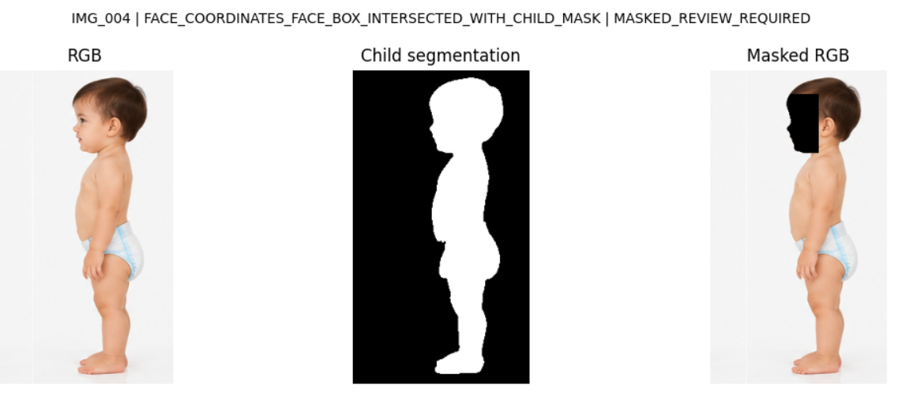

# Face Anonymization Pipeline

A Python-based face anonymization pipeline that combines face detection, child segmentation, and pose estimation to mask facial regions in images.

The pipeline handles missing face coordinates, missing segmentation masks, multiple-person scenarios, and uncertain pose predictions.

## Visual Example

The following example uses an AI-generated synthetic image and shows the original RGB image, child segmentation mask, and masked RGB output.



**Image:** IMG_004

**Masking Logic:** `FACE_COORDINATES_FACE_BOX_INTERSECTED_WITH_CHILD_MASK`

**Status:** `MASKED_REVIEW_REQUIRED`

The mask was generated using available face coordinates and the child segmentation mask. This example demonstrates segmentation-aware masking and remains flagged for manual review.

## Features

- Face masking using detected face coordinates.
- Segmentation-aware masking using a 75% intersection threshold.
- Pose-based face localization when face coordinates are unavailable.
- Multiple-person handling using pose confidence and completeness checks.
- Automatic handling of missing segmentation masks.
- Manual-review flags for uncertain predictions.
- Visualization of original RGB, child segmentation, and masked RGB.
- CSV output containing masking results and processing status.

## Sample Dataset

**Sample Dataset:** The images included in this repository are AI-generated synthetic images created for demonstrating and testing the face anonymization pipeline. They do not represent real research participants or actual child anthropometric data.

The repository includes `samples.zip`, containing synthetic RGB images, available segmentation masks, and an `images.csv` file.

Some face coordinates and segmentation masks are intentionally missing to demonstrate fallback handling.

## Installation

Requires Python 3.10 or newer.

```bash
python -m venv .venv
```

Activate the environment:

Linux/macOS:

```bash
source .venv/bin/activate
```

Windows:

```bash
.venv\Scripts\activate
```

Install the package:

```bash
pip install -e .
```

## Running the Pipeline

Extract the sample dataset:

```bash
python -m zipfile -e samples.zip .
```

Run the masking pipeline:

```bash
python -m face_masking --data ./samples
```

Display the original RGB, segmentation mask, and masked RGB:

```bash
python -m face_masking --data ./samples --display
```

## Face Masking Logic

### 1. Face Coordinates Available

- Generate a face rectangle using the available face coordinates.
- If child segmentation is available, calculate the intersection between the face rectangle and child segmentation mask.
- If the intersection covers at least 75% of the face rectangle, use the intersected region.
- Otherwise, use the original face rectangle.
- If segmentation is missing, use the original face rectangle.

### 2. Face Coordinates Missing

Use pose estimation to identify the facial region.

- If child segmentation is available, run pose estimation on the segmented child RGB.
- If segmentation is unavailable, run pose estimation on the original RGB.
- If pose estimation fails or the keypoints are unreliable, flag the image for manual review.

### 3. Multiple-Person Handling

When multiple people are detected:

- Require person detection confidence ≥ 0.75.
- Require at least 75% pose completeness, calculated using keypoints with confidence ≥ 0.50.
- Select the smallest bounding box among qualifying candidates.
- If no candidate satisfies these conditions, flag the image for manual review.

### 4. Pose-Based Face Mask Generation

- Identify eye and nose keypoints.
- Construct a face region using the eye line and nose.
- Extend the upper boundary 20% above the eye line.
- Extend the lower boundary 30% below the nose.
- Intersect the generated face region with the child segmentation mask when available.
- If child segmentation is missing, use the generated face region directly.

The pipeline uses:

```python
POSE_FACE_SCALE = 1.0
```

This preserves the original pose-generated face region without additional enlargement.

### 5. Manual Review

Images are flagged for manual review when reliable face localization is not possible or when generated masks require additional verification.

## Output

The pipeline generates:

- Masked RGB images.
- Binary face masks.
- An updated CSV containing masking status, masking logic, and output paths.
- Visualizations showing original RGB, child segmentation, and masked RGB.

Outputs are saved under `samples/masked_outputs/`, and the results CSV is saved as `samples/images_with_masking_results.csv`.

## Testing

```bash
pip install -e '.[test]'
pytest -q
```

## Demo Purpose and Limitations

**This face anonymization pipeline is developed for demonstration and experimental purposes only.**

The face-masking logic is not fully optimized or validated for all possible conditions. It demonstrates a rule-based approach combining face coordinates, child segmentation masks, and pose estimation to handle different scenarios, including missing data.

The current implementation may not perform reliably in all situations, particularly when:

- Multiple people are present.
- Faces are partially occluded or rotated.
- Pose estimation produces inaccurate keypoints.
- Segmentation masks are incomplete or incorrect.
- Face coordinates are inaccurate or unavailable.

The masking thresholds and face-region generation rules are experimental and may require further optimization for different datasets and real-world conditions.

**Generated masks do not guarantee complete face anonymization.** Manual verification and additional validation are required before using this approach with real or sensitive images.

This repository is intended to demonstrate the pipeline's workflow, fallback mechanisms, and decision-making logic rather than provide a production-ready anonymization solution.

## Privacy and Publishing

The sample dataset contains synthetic images intended for demonstration.

Do not upload confidential datasets, identifiable images of real children, private credentials, or proprietary code without authorization.

Review the applicable Ultralytics software and model licensing terms before commercial deployment or redistribution.
